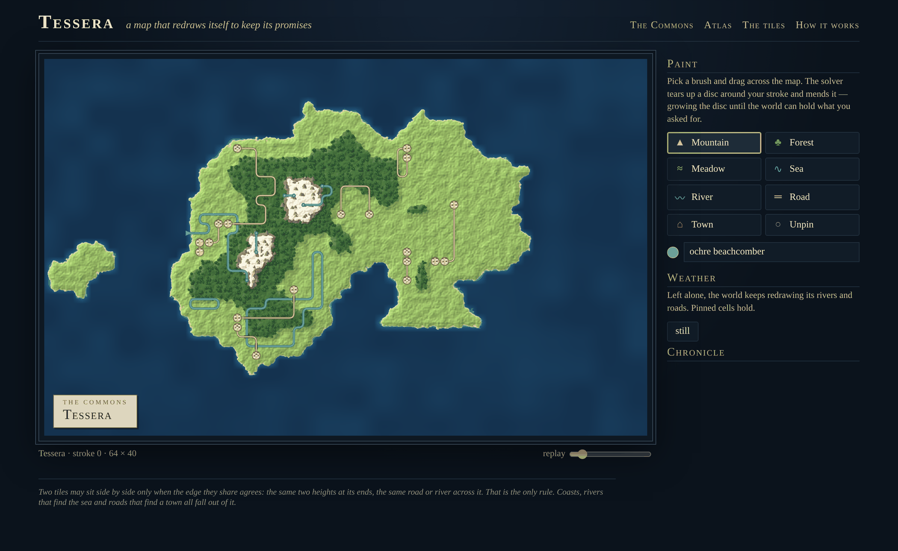
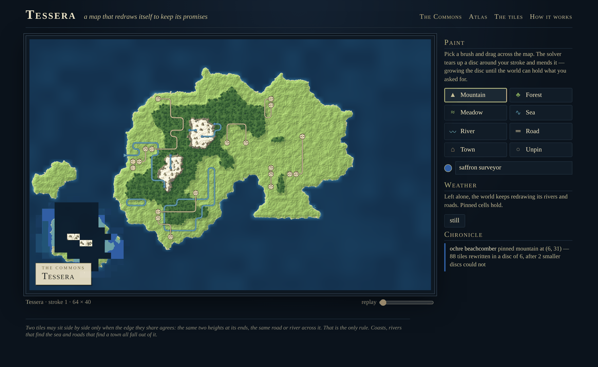
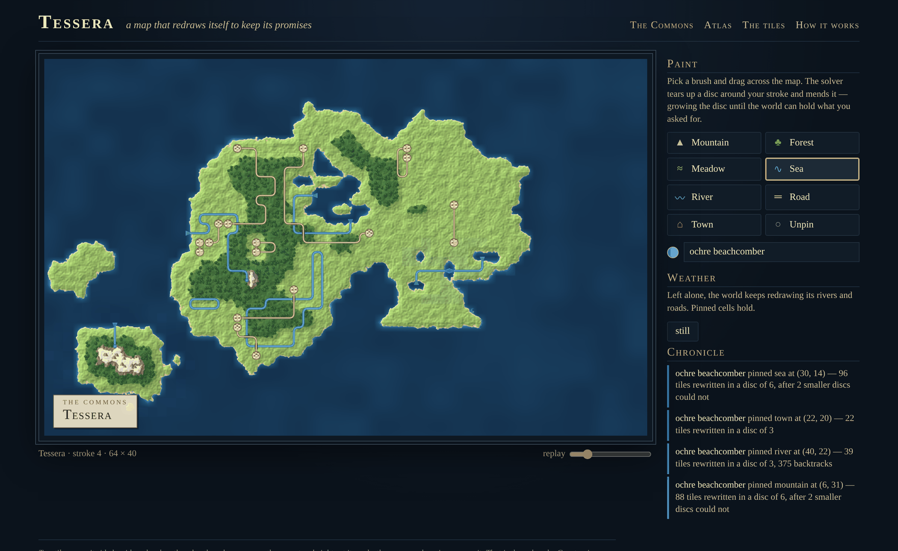
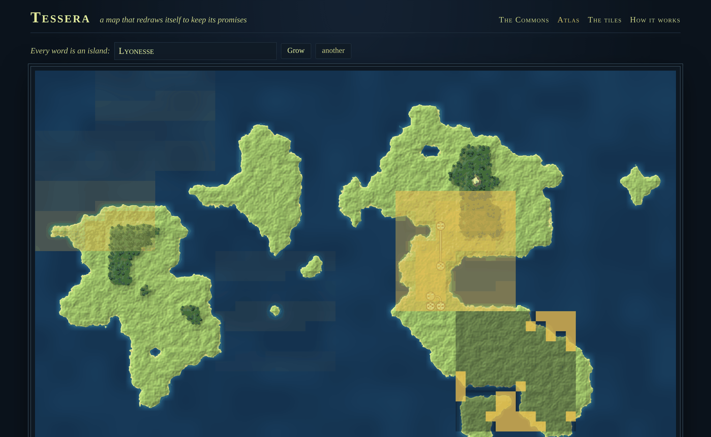
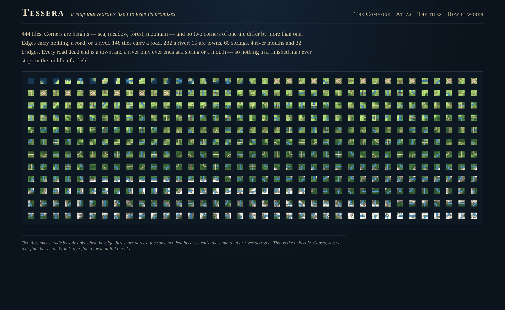

# Tessera

**A map that redraws itself to keep its promises.**

> **`./verify.sh` is the authoritative gate.** It runs on the pinned toolchain
> (rustc 1.97.1) and runs Verus over `verus/`. The gates run during the cloud
> build — fmt, clippy, tests, the JS-parity check, a boot with an end-to-end
> CSRF paint — are a weaker pre-check on a different machine with **no Verus
> at all**. Until `./verify.sh` is green on the Mac, the proofs are unchecked.

```sh
cargo run --release -p tessera-app    # then open http://localhost:3000 — twice
```

No database, no Docker, no API keys.



## What it is

An island is a grid of tiles. Each tile has a height at each corner — sea,
meadow, forest, mountain — and on each edge nothing, a road or a river. Two
tiles may sit side by side only if they agree completely about the edge they
share. That is the only rule. A wave-function-collapse solver (arc-consistency
propagation, chronological backtracking) fills the map, and out of that one
rule fall coasts that never tear, rivers that rise at springs and leave through
mouths, and roads whose every dead end is a town.

**The Commons** is one shared island, live in every open browser. Pick a brush
and drag. The server pins your brush to the stroke, tears up a disc around it,
re-solves the disc with everything outside held fixed, and grows the disc
until the world can hold what you asked for. Everyone watches the search
replay tile by tile in your colour; when the solver changes its mind, the
undone tiles flash red.



Drop a mountain in open sea and an island rises to meet it — shallows, beach,
foothills, and a river already running down to its own mouth. Paint a river
across a meadow and the map has to find it a spring and a sea. Paint the sea
into the middle of a forest and a lagoon opens, with the roads rerouted round
it. Leave it alone and **the weather** re-solves a small disc every few
seconds with the land held still: rivers wander, towns come and go, except
where someone pinned something.



**The atlas** grows any word's island in your browser with a bit-exact
JavaScript port of the engine — watch the blocks sweep the geology and fill it
with rivers and towns — and can make it the Commons. **The tiles** page lays
out all 444 tiles.




## How it works

* `crates/tessera` — the engine. No IO, no async, no clock.
  `tiles.rs` enumerates the tileset; `wave.rs` is the solver and its
  replayable trace; `check.rs` an independent checker; `world.rs` the world:
  bare geology (integer noise relaxed until smooth — already a consistent
  map), then **only ever whole passes** — re-solve a region with the outside
  fixed, commit only on success. Generation, painting and drift are all
  passes. So the map keeps every promise between every two strokes.
* `crates/tessera-app` — autumn-web 0.9: Maud pages, one SSE topic, the
  Commons in memory (`docs/adr/0001`), a tokio weather loop.
  `engine.js` is the port, `render.js` the atlas-plate renderer.
* `verus/src/tessera.rs` — revise is sound, the socket shortcut equals
  revise, propagation terminates, banning is sound, the splice keeps the map
  consistent and untouched outside the region, relaxation yields smooth
  corners and terminates. `docs/SPEC.md` §5 ranks each by confidence.
* `tools/parity.js` — the browser engine against the Rust engine on
  generated, painted and drifted worlds and every trace event.

## What works today

Everything above: 38 tests (16 engine unit, 6 property suites + 4 laws, 6 app
unit, 5 HTTP against a real `TestApp`, 1 doctest); parity identical over 8
islands; boot + CSRF paint end to end.

## Where it could go

* **An infinite atlas.** Solve chunks on demand against their neighbours'
  borders — the repair-in-blocks machinery is already the hard half — and
  walk forever.
* **Rivers that know where they're going.** River loops are legal under a
  purely local rule. A global pass (or a "flow" bit on river sockets that must
  decrease toward the sea) would make every river drain.
* **Tilesets as data.** Hex grids; a walled-city grammar; a dungeon set.
* **A stroke log.** The world is a pure function of its word and its strokes;
  one SQLite table replayed at boot makes the Commons survive restarts.
* **Print it.** Export a plate as SVG with a hand-lettered cartouche.
